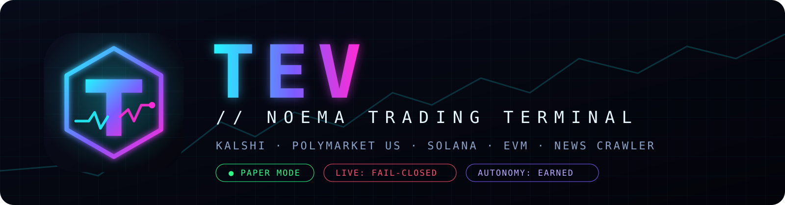
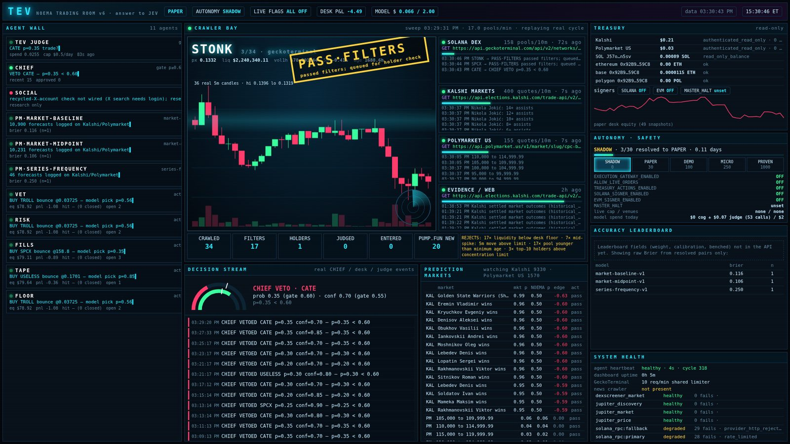
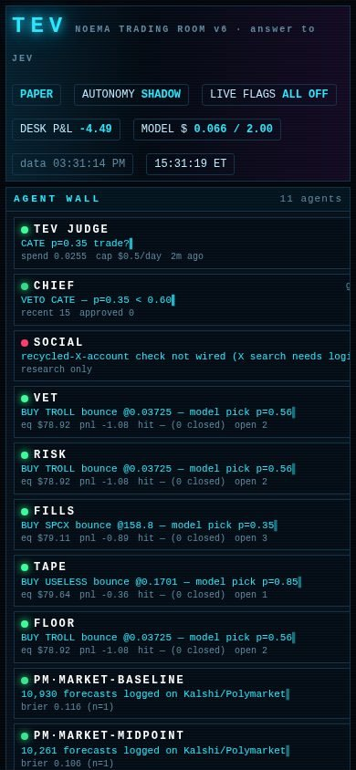
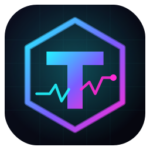
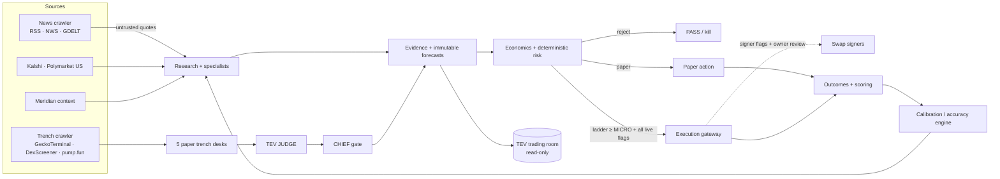
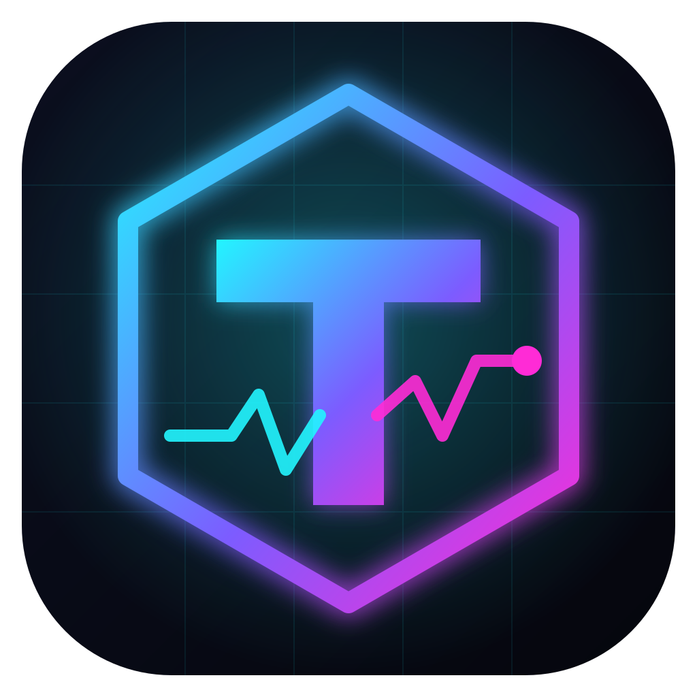

<div align="center">



<br />

# NOEMA &nbsp;·&nbsp; TEV

### Observe. Infer. Verify. Act.

**An evidence-first autonomous agent runtime for prediction markets, on-chain research and bounded machine action — with TEV, its private neon trading room.**

[](https://github.com/gryszzz/NOEMA/actions/workflows/verify.yml)


[TEV trading room](#tev-trading-room) ·
[Mac app](#tev-mac-app) ·
[Quick start](docs/quick-connect.md) ·
[Operator guide](docs/operator-guide.md) ·
[Architecture](docs/architecture.md) ·
[Brand](docs/brand.md) ·
[Meridian](https://github.com/gryszzz/Meridian-Intel)

</div>

---

## Contents

- [The mission](#the-mission) · [Reality-first status](#reality-first-status) · [TEV trading room](#tev-trading-room) · [TEV Mac app](#tev-mac-app)
- [Venues](#venues) · [News crawler](#news--evidence-crawler) · [Trench desks](#trench-desks-paper-only) · [TEV JUDGE + CHIEF](#decision-pipeline-tev-judge--chief)
- [Earned-autonomy ladder](#earned-autonomy-ladder) · [Fail-closed flags](#fail-closed-execution-flags) · [Swap signers](#swap-signers) · [In progress](#in-progress)
- [Architecture](#system-architecture) · [Self-hosting](#self-hosting) · [Start with one cycle](#start-with-one-cycle) · [Repository map](#repository-map)

## The mission

> **Increase autonomy only when evidence, economics, and authority boundaries can support it.**

NOEMA observes markets, news and on-chain data, records forecasts before outcomes, scores them chronologically, and only earns trading authority from that measured record. **TEV** is its trading terminal — the private, read-only room where you watch the crawlers, desks and gates work in real time. Paper results are not revenue, and nothing here promises profit.

## Reality-first status

NOEMA separates **implemented capability** from **future authority**.

| Layer | Current repository state |
| --- | --- |
| Research runtime | Persistent specialist ecosystem, bounded research attention, missions, experiments, evidence, immutable forecasts, and outcome evaluation |
| Cognition | Optional model-assisted reasoning behind explicit configuration and budget gates |
| Prediction markets | Kalshi and Polymarket integrations for market/account observation where configured; paper research remains the default operating mode |
| Web3 | Trench crawler + five paper-only desks on Solana; EVM/Solana wallets observed read-only |
| News | `noema-news` evidence crawler (RSS/Atom, NWS, GDELT) matched to watched markets; quoted as untrusted data only |
| Meridian | Frozen request/review bridge for world-intelligence context; no always-on shared service is implied |
| Economic OS | Cash, reservations, costs, budgets, measured outcomes, and reconciliation rules remain distinct |
| Wallets | Observed wallet/network state can be surfaced; visibility never grants signing or transfer authority |
| Execution | Deterministic gateway exists and is **fail-closed by default**; a visible gateway is not proof of live trading |
| Ops Console | Runtime-backed Economic Habitat, inspectors, replay, live capital surfaces, work packets, and Autonomous Desk |
| Public site | Static documentation/report explorer; it is not the private worker or authority surface |

**Paper results are not revenue. Wallet observations are not authority. Missing state stays missing.**

See [Economic integrity](docs/economic-integrity.md) and [Production boundaries](docs/production-boundaries.md).

## TEV trading room

TEV is NOEMA's private, **read-only** war room served by `noema-dashboard` (port `8787`). Every panel renders real crawler, desk, venue and wallet records; empty or unavailable sources say so instead of faking activity. No page can place orders.

<p align="center"></p>

| Page | What it shows | API |
| --- | --- | --- |
| `/trading-room` (v6) | Crawler bay hero (cards flip through each scanned token's real chart and stamp PASS / REJECT / CHIEF VETO with the reason), crawler lanes incl. the live **news lane**, agent wall, decision stream, Kalshi/Polymarket board, treasury (Solana + EVM, signer status), accuracy leaderboard, safety switches | `/api/trading-room`, `/api/room-v6`, `/api/accuracy` |
| `/trading-room-v5` | TEV CRAWLER card flip, decision graph, CHIEF dial, pool hex map | `/api/trading-room` |
| `/trading-room-v4` | Neon pixel room: agent panels, crawler radar, balance ribbon | `/api/room-v4` |
| `/command-center` | 4×4 grid: prediction scanner, forecast ledger / Brier / calibration, gateway, ladder, model budget, health | `/api/command-center` |
| `/trench-desks` | Original paper-desk panel | `/api/trench-desks` |

`/api/accuracy` is a read-only route on the private dashboard (`noema-dashboard`). It returns per-agent Brier, calibration, weight, and bench status. The public site (`site/`) does not serve it and does not receive signer material.

<details><summary>Phone view</summary>
<p align="center"></p>
</details>

## TEV Mac app



The dashboard ships as an installable app:

- **PWA** — `/manifest.webmanifest`, `/favicon.ico`, `/apple-touch-icon.png` and `noema/static/brand/tev/` icons. In Safari use **File › Add to Dock**; in Chrome use **Install TEV**.
- **TEV.app** — `apps/macos/` holds a tiny macOS bundle (`Info.plist`, `icon.icns`, launcher). It opens the room in a chromeless window via Chrome / Brave / Edge `--app=` mode, falling back to Safari. Set the URL in `TEV.app/Contents/Resources/tev-url.txt` or `~/.tev-url`. Build the zip with `apps/macos/build.sh` (needs `cairosvg` + `Pillow` to re-render icons). It is unsigned: right-click › **Open** on first launch.

The logo source is a single vector file: [`noema/static/brand/tev/tev-logo.svg`](noema/static/brand/tev/tev-logo.svg).

## Venues

| Venue | Status in code |
| --- | --- |
| Kalshi | Market + authenticated account observation; live orders only through the fail-closed gateway |
| Polymarket US | Market observation + gated live adapter (`polymarket_us`, off by default) |
| Solana memecoins | Trench crawler (GeckoTerminal, DexScreener, pump.fun) feeding **paper-only** desks |
| EVM (ETH / Base / Polygon) | Wallet balances observed read-only (`evm_watch.py`); no trading in `main` |
| Kraken / Robinhood | Not integrated |

## News / evidence crawler

`noema-news` (`noema/news_crawler.py`) is a free, read-only evidence crawler for the prediction-market agents:

- **Sources:** public RSS/Atom (BBC, NPR, Federal Reserve, BEA, SEC press releases, CourtListener SCOTUS), National Weather Service severe alerts, Google News RSS queries and the GDELT doc API.
- **Polite:** outbound HTTPS only, per-host spacing, `robots.txt` respected, conditional GET caching.
- **Matching:** deterministic keyword/IDF scoring against watched Kalshi and Polymarket markets — no model spend.
- **Safe by construction:** every crawled string is untrusted; it is cut to short snippets, instruction-like phrases are redacted, and it is only ever quoted as data. The crawler cannot place orders, call tools or change configuration.

## Trench desks (paper only)

Five parallel desks — **VET, RISK, FILLS, TAPE, FLOOR** — each with its own bankroll slice. A desk holds a ~10% core leg and trades bounces with the rest; it is fired after **2 consecutive losses** and replaced by a mutated successor. Fills stay paper unless every gate in `docs/solana-live-swaps.md` is set.

| Entry filter (`trench_risk.py`) | Default |
| --- | --- |
| Top-10 holder concentration | ≤ 60% |
| Pool age | ≥ 1 hour |
| Liquidity | ≥ $12,000 |
| Mid-spike guard | no entry if 5m move > 15% or accelerating |
| Stops (bounce & core) | hard ceiling < 8% |

## Decision pipeline: TEV JUDGE + CHIEF

`CRAWLER → FILTERS → VET → TEV JUDGE → CHIEF → FILLS / RISK / SIZE`

- **TEV JUDGE** — optional typed model judgement that only picks among candidates already passing deterministic rules; budget-capped (`NOEMA_DESK_JUDGEMENT_MAX_USD_PER_DAY`).
- **CHIEF** — approves a pick only if probability ≥ `0.60` and confidence ≥ `0.55` (`NOEMA_CHIEF_MIN_PROBABILITY`, `NOEMA_CHIEF_MIN_CONFIDENCE`).
- **SOCIAL** — research-only seat; currently a placeholder.
- **Trading coordinator** (`trading_coordinator.py`) — closes forecast → proposal → venue → fill each cycle (paper by default) and applies earned-autonomy sizing.

## Earned-autonomy ladder

Autonomy is computed from evidence (`noema/autonomy.py`), never granted by config.

| Level | Evidence required | Live sizing (per trade / per day) |
| --- | --- | --- |
| SHADOW | < 30 resolved forecasts | none |
| PAPER | ≥ 30 resolved | none |
| DEMO | ≥ 100 resolved, ≥ 7 live-observation days | none |
| MICRO | ≥ 250 resolved, ≥ 21 days (plus further gates) | 1% / 10% |
| PROVEN | ≥ 1000 resolved, ≥ 60 days, ≥ 30 profitable days | 3% / 30% |

The authority config also defines SELF_FUNDED (5% / 50%) and EXPANSION (8% / 80%) tiers. Nothing trades live below MICRO, and `NOEMA_LIVE_REQUIRES_OWNER_REVIEW=1` by default.

## Fail-closed execution flags

Every flag defaults to off; all must be set for any live order.

| Flag | Default | Meaning |
| --- | --- | --- |
| `NOEMA_EXECUTION_GATEWAY_ENABLED` | `0` | Gateway accepts nothing unless `1` |
| `NOEMA_ALLOW_LIVE_ORDERS` | `0` | Second independent live switch |
| `NOEMA_LIVE_VENUES` | empty | Explicit venue allowlist |
| `NOEMA_MAX_LIVE_DAILY_NOTIONAL_USD` | unset | Daily notional cap |
| `NOEMA_MASTER_HALT` | `0` | `1` halts everything |
| `NOEMA_LIVE_REQUIRES_OWNER_REVIEW` | `1` | Owner must review live actions |
| `NOEMA_SOLANA_SIGNER_ENABLED` | `0` | Solana signing off |
| `NOEMA_SOLANA_OWNER_REVIEWED` | `0` | Solana swap owner review; not settable over IPC |
| `NOEMA_EVM_SIGNER_ENABLED` | `0` | EVM swap signing off |
| `NOEMA_EVM_OWNER_REVIEWED` | `0` | EVM swap owner review; not settable over IPC |
| `NOEMA_TREASURY_ACTIONS_ENABLED` | `0` | Treasury moves off |

## Swap signers

Solana (Jupiter) and EVM (KyberSwap on Ethereum, Base, and Polygon, with Robinhood Chain reserved) swaps run in a **separate signer process**. Keys are read only from `NOEMA_SOLANA_SIGNER_SECRET` and `NOEMA_EVM_SIGNER_SECRET` in that process. The signers refuse any key whose address is not `J57oJ1GAraQuts7htkrRN7mzhkq93sqM3iRKMRuHn5sv` (Solana) or `0x92B9a0C66a37fE9635e55045b3bf40cB035a59C8` (EVM). They ship **disabled**, simulate before send, and size caps from the autonomy ladder. Enablement checklists: `docs/solana-live-swaps.md` and `docs/evm-live-swaps.md`.

## In progress

Not in `main` yet — listed so the roadmap stays honest.

| Work | Status |
| --- | --- |
| **Swap signers** ([#108](https://github.com/gryszzz/NOEMA/pull/108)) — Jupiter (Solana) + EVM aggregator signers in a separate process; sign only for NOEMA's own addresses, simulate first, ship **disabled** with a daily cap | ✅ Merged (ships disabled) |
| **Accuracy engine** ([#116](https://github.com/gryszzz/NOEMA/pull/116)) — per-agent Brier, calibration, and CHIEF influence from resolved forecasts. Public-history baseline (24h before close, no keys): Kalshi midpoint Brier **0.1205** (n=60); series-frequency **0.1885** (n=29, weight 0, 17 no-edge skips); CHIEF shadow Brier **0.154** (n=29); Polymarket CLOB midpoint **0.2765** (n=18); Polymarket US history HTTP 401, scored **0**; Solana OHLCV shadow **0.3308** (n=228, live entry gate passed 0). Paper scoring only. | ✅ Merged |

## A living operating system

NOEMA's console is no longer just a table of records. It projects canonical runtime state into a spatial operating world.

### Economic Habitat

The habitat organizes real entities into functional zones:

- **Cognition Array** — model and data providers
- **Agent Colony** — registered specialists and handoff participants
- **Mission Control** — persisted active missions
- **Market Deck** — markets and immutable forecasts
- **Evidence Vault** — evidence, sessions, experiments, lessons, and recorded outputs
- **Treasury & Gateway** — wallets, runtime tools, policy, and execution boundary

Agents move or light rooms only when persisted assignments, handoffs, or mission relationships support the visualization. Historical replay hides later/current-only state.

### Autonomous Desk

Phase 3 adds an auditable, single-responsibility desk model:

```text
CHIEF → SCOUT → MAP / CONTEXT → VET → ODDS → SIZE → EXECUTION → RISK / EXIT
```

These are **presentation roles over canonical entities**, not magically-created agents. If NOEMA cannot defensibly bind a real registered specialist or tool to a seat, the seat stays:

```text
VACANT / UNBOUND
```

Active Work Packets reconstruct mission routes from exact assignments and persisted handoffs. The Shift Tape reuses NOEMA's canonical event timeline.

Read the full contract in [Economic Habitat](docs/economic-habitat.md).

## System architecture



<sub>The accuracy engine scores forecasts and can shrink paper influence to zero. It does not arm live execution; the gateway stays separately gated and fail-closed.</sub>

## Self-hosting

NOEMA runs self-hosted on a single box: `noema-agent` (worker), `noema-dashboard` (TEV, `127.0.0.1:8787`) and optionally `noema-news`. For remote viewing, put the dashboard behind a private, authenticated, **GET-only** proxy on a private network (e.g. Tailscale) — never expose write/control endpoints. `render.yaml` and the Render docs are **legacy** and not the current deployment.

## What makes NOEMA different

**Evidence over theater.** The UI is allowed to look alive only when canonical state supports it.

**Bounded specialists.** Research attention is allocated across specialist families instead of assuming one universal model should do everything.

**Chronological evaluation.** Forecasts are recorded before outcomes and scored later; winning streaks are not promotion criteria.

**Economic honesty.** Model/API/compute costs, cash, reservations, paper outcomes, and reconciled economic value remain separate concepts.

**Deterministic authority.** Model output can propose; deterministic policy governs whether action is even eligible.

**Restraint is valid.** NOEMA may leave capital, compute, or attention unused when nothing clears the evidence threshold.

## Roadmap

| Phase | State | Direction |
| --- | --- | --- |
| **01 · Reality-first console** | ✅ Done | Evidence-backed operations view, replay, diagnostics, economics |
| **02 · Living habitat** | ✅ Done | Inhabitants, workstations, mission occupancy, handoffs |
| **03 · Autonomous Desk + TEV** | ✅ Done | Desk seats, paper trench desks, TEV JUDGE / CHIEF, TEV trading room v6, news crawler |
| **04 · Accuracy + signers** | 🟡 In progress | Accuracy engine merged (#116, paper scoring only); swap signers still draft (#108); earned-autonomy sizing wired |
| **05 · Policy-gated live execution** | 🔒 Gated | Only after the ladder reaches MICRO, owner review, and every live flag is set |

The roadmap is directional. It does **not** grant execution authority or claim profitability.

## Start with one cycle

Python 3.12+, from a checkout:

```sh
python -m venv .venv
source .venv/bin/activate
pip install -e ".[dev]"

noema agent-once
noema doctor
noema ladder
```

Run the continuous paper worker:

```sh
noema-agent
```

Run the news/evidence crawler (optional, default every 900 s):

```sh
noema-news
```

Run the private/local Ops Console:

```sh
noema-dashboard
# http://127.0.0.1:8787
```

Public observation paths may require network access. Optional providers, authenticated account observation, cognition, and hosted services require their own configuration. See [Quick connect](docs/quick-connect.md).

## Inspect the economics

```sh
noema economics-report > economics-report.json
```

The public explorer can import that report locally in the browser. The importer checks consistency; it does not authenticate a runtime or prove receipts.

Full net economic profit remains **unknown** until the relevant costs, transfers, balances, and realized outcomes are reconciled.

## Build and verify

```sh
ruff check .
pytest -q

npm ci
npm run site:test
npm run ops:test
npm run site:build

npx playwright install chromium
npm run site:qa
npm run ops:qa
```

The repository's **NOEMA Verify** workflow runs the Python suite, Node contracts, static-site build, and production browser QA on changes.

## NOEMA + Meridian

NOEMA and [Meridian](https://github.com/gryszzz/Meridian-Intel) have separate responsibilities.

**Meridian** organizes world evidence, entities, relationships, events, and timelines.

**NOEMA** consumes frozen research context, performs bounded economic research, records forecasts/decisions, evaluates outcomes, and enforces its own authority/economic boundaries.

The bridge is intentionally explicit and hash-bound. Meridian context does not become an order merely because NOEMA can read it.

See [Meridian ↔ NOEMA contract](docs/meridian-noema-contract.md).

## Repository map

| Area | Purpose |
| --- | --- |
| `noema/` | Python runtime: research, venues, trench desks, news crawler, economics, gateway, persistence |
| `noema/static/` | TEV trading rooms, Ops Console, brand assets (`brand/tev/`) |
| `apps/macos/` | TEV.app bundle source + `build.sh` |
| `site/` | Static public experience and local report explorer |
| `docs/` | Architecture, operating contracts, evidence/economic boundaries, setup |
| `tests/` | Python + Node regression and truth-contract tests |
| `scripts/` | Browser QA and build/verification tooling |
| `render.yaml` | **Legacy** Render blueprint |

## Read next

- [Master mission](docs/master-mission.md) · [Agent ecosystem](docs/agent-ecosystem.md) · [Economic Habitat](docs/economic-habitat.md)
- [Prediction venues](docs/prediction-venues.md) · [Polymarket US trading](docs/polymarket-us-trading.md) · [Execution gateway](docs/execution-gateway.md)
- [Trench-1](docs/trench-1.md) · [Agent wallet](docs/agent-wallet.md) · [Economic integrity](docs/economic-integrity.md)
- [Production boundaries](docs/production-boundaries.md) · [Live workstation](docs/live-workstation.md) · [Brand system](docs/brand.md)

---

<div align="center">



**Evidence → Belief → Edge → Restraint**

<sub>NOEMA is an experimental research and agent-runtime project. Nothing in this repository is a guarantee of profit, a promise of self-funding, or automatic authorization to place orders or move funds.</sub>

</div>
